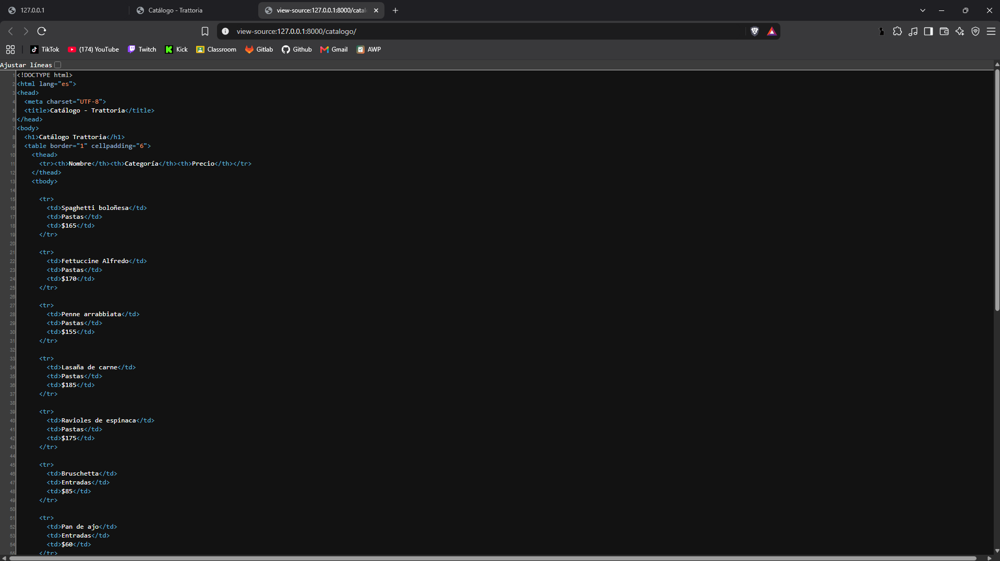
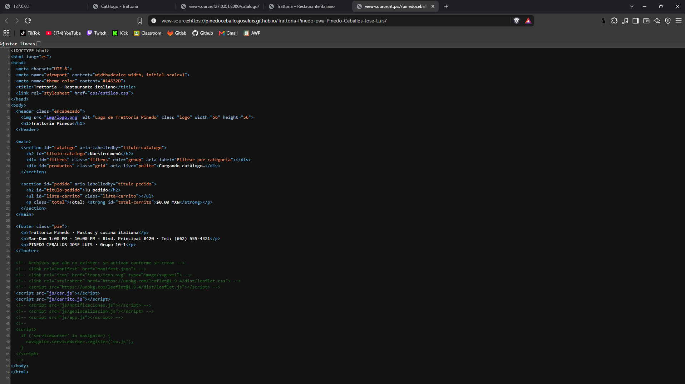
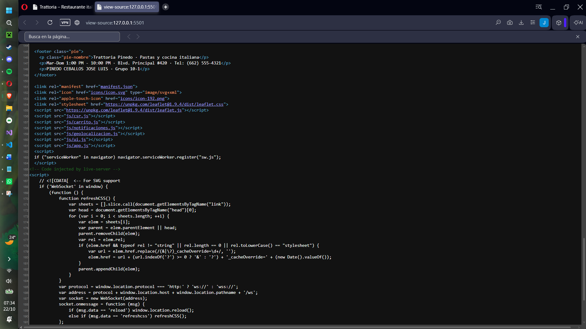
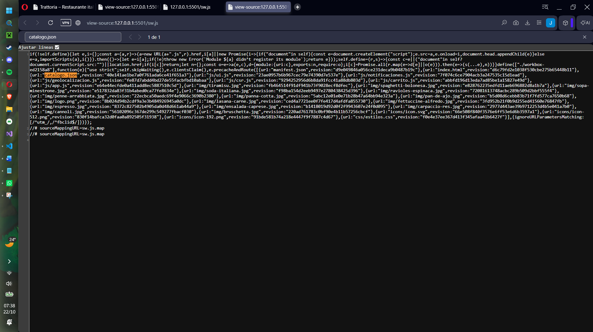
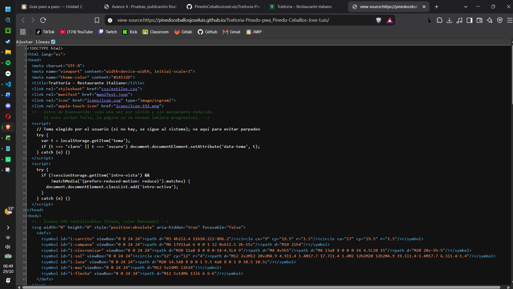
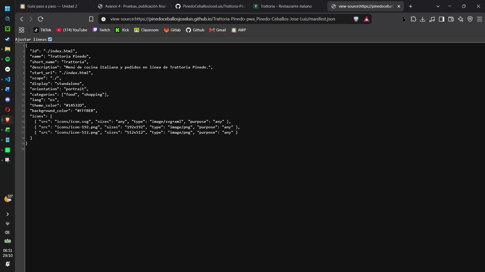
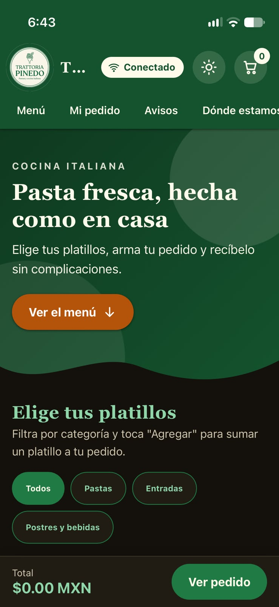

# Trattoria – PWA de ventas

| Dato | Valor |
|---|---|
| **Alumno** | PINEDO CEBALLOS JOSE LUIS |
| **Grupo** | ING 10-1 |
| **Negocio · giro** | Trattoria · Restaurante italiano casual (pastas, entradas y postres) |
| **URL del repositorio** | https://github.com/PinedoCeballosJoseLuis/Trattoria-Pinedo-pwa_Pinedo-Ceballos-Jose-Luis |
| **URL de GitHub Pages** | https://pinedoceballosjoseluis.github.io/Trattoria-Pinedo-pwa_Pinedo-Ceballos-Jose-Luis/ |

## Historial de avances

| Avance | Hash del commit entregado | Fecha |
|---|---|---|
| 1 | 8169dd3 | 09/10/2026 |
| 2 | e6d75ff | 17/10/2026 |
| 3 | 073434b | 25/10/2026 |
| 4 | (se escribe en el reporte PDF) | — |

## Comparación SSR vs CSR

Al presionar Ctrl+U (ver código fuente) se nota la diferencia: en SSR el servidor Django entrega los productos ya escritos en el HTML; en CSR el HTML llega con el `
` vacío y los productos los dibuja el JavaScript en el navegador.

## Funciones PWA (avance 3)

### index.html: manifest y registro del Service Worker activos

### sw.js: Workbox precachea el catálogo y las fotos

## Versión publicada (avance 4)

### index.html en GitHub Pages

### manifest.json en GitHub Pages

### Mi app instalada en el celular

## Guía de instalación de la app para celulares

La app se puede instalar directamente desde el navegador en esta URL: [Trattoria Pinedo](https://pinedoceballosjoseluis.github.io/Trattoria-Pinedo-pwa_Pinedo-Ceballos-Jose-Luis/).

### Android (Chrome)

1. Abre **Chrome** en tu celular y visita la URL de GitHub Pages.
2. Espera a que cargue el catálogo. El Service Worker se registra al cargar la página.
3. Toca el menú de **tres puntos (⋮)**, arriba a la derecha.
4. Selecciona **Instalar app** o, según tu versión de Chrome, **Agregar a la pantalla principal**.
5. Confirma tocando **Instalar**.
6. El ícono de **Trattoria** aparecerá en la pantalla de inicio o en el cajón de aplicaciones.
7. Toca el ícono para abrir la app en una ventana independiente, sin la barra de direcciones.

### iPhone (Safari)

> En iPhone, abre la URL con **Safari** para poder agregar la app a la pantalla de inicio.

1. Abre **Safari** y visita la URL de GitHub Pages.
2. Espera a que cargue el catálogo.
3. Toca **Compartir** (el cuadro con una flecha hacia arriba).
4. Desplázate por las opciones y selecciona **Agregar a pantalla de inicio**.
5. Deja el nombre **Trattoria** o cámbialo y toca **Agregar**.
6. El ícono de **Trattoria** aparecerá en la pantalla de inicio.
7. Toca el ícono para abrir la app desde la pantalla de inicio.