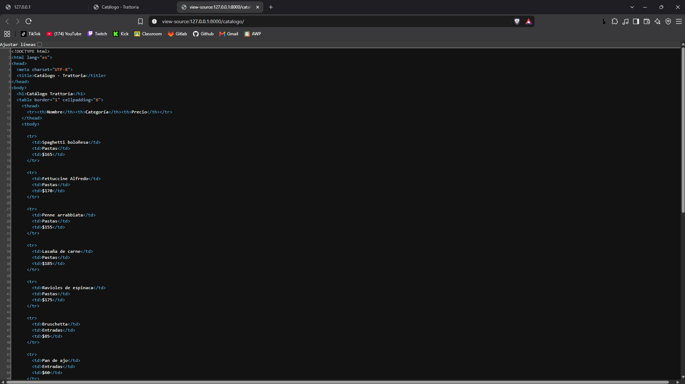
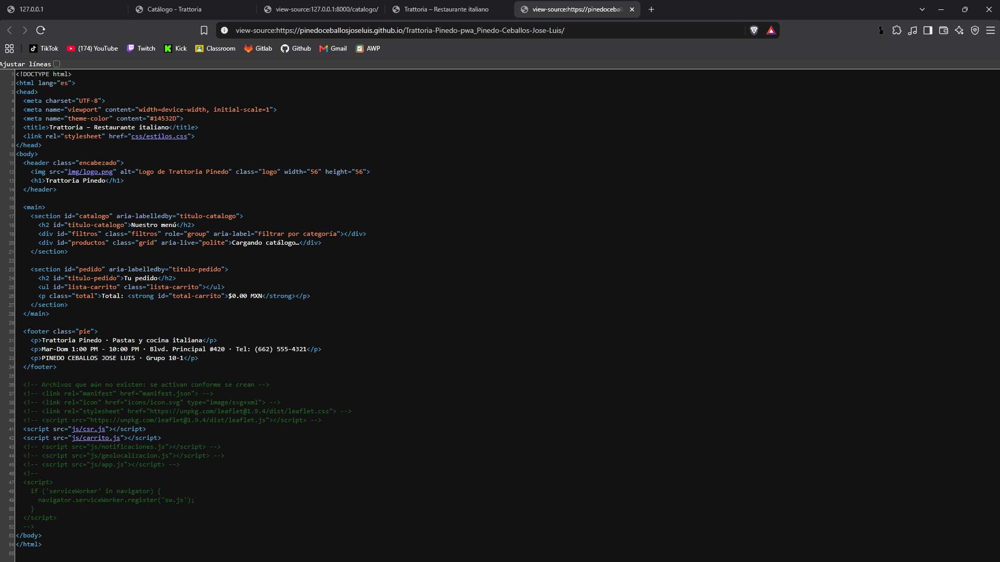
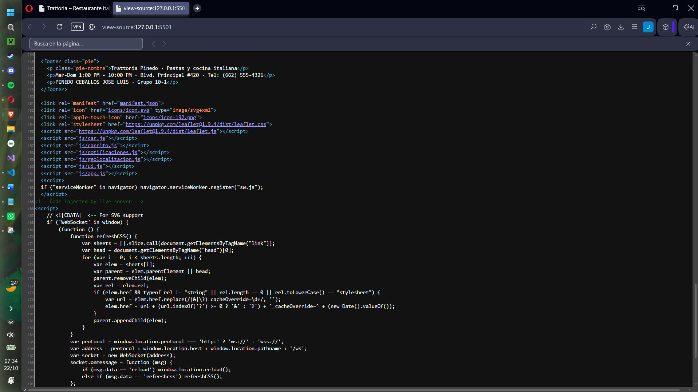
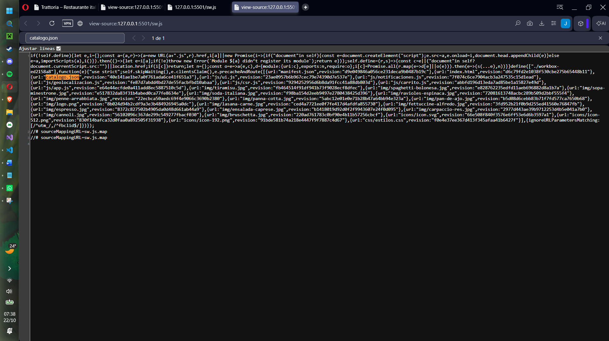
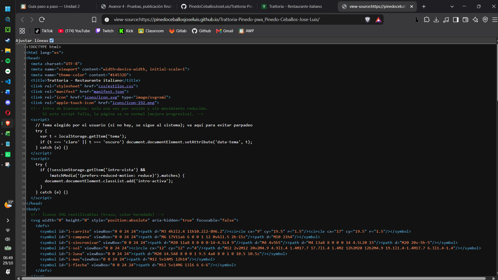
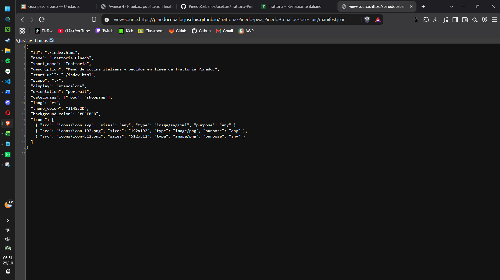
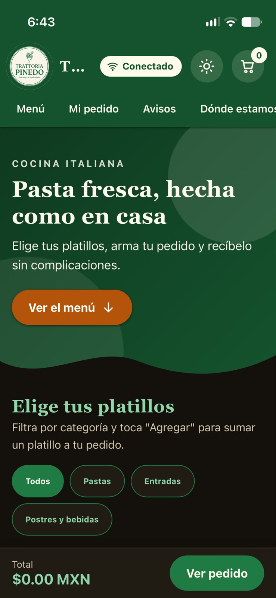

# Trattoria – PWA de ventas

| Dato | Valor |
|---|---|
| **Alumno** | PINEDO CEBALLOS JOSE LUIS |
| **Grupo** | ING 10-1 |
| **Negocio · giro** | Trattoria · Restaurante italiano casual (pastas, entradas y postres) |
| **URL del repositorio** | https://github.com/PinedoCeballosJoseLuis/Trattoria-Pinedo-pwa_Pinedo-Ceballos-Jose-Luis |
| **URL de GitHub Pages** | https://pinedoceballosjoseluis.github.io/Trattoria-Pinedo-pwa_Pinedo-Ceballos-Jose-Luis/ |

## Historial de avances

| Avance | Hash del commit entregado | Fecha |
|---|---|---|
| 1 | 8169dd3 | 09/10/2026 |
| 2 | e6d75ff | 17/10/2026 |
| 3 | 073434b | 25/10/2026 |
| 4 | (se escribe en el reporte PDF) | — |

## Comparación SSR vs CSR

Al presionar Ctrl+U (ver código fuente) se nota la diferencia: en SSR el servidor Django entrega los productos ya escritos en el HTML; en CSR el HTML llega con el `
` vacío y los productos los dibuja el JavaScript en el navegador.

## Funciones PWA (avance 3)

### index.html: manifest y registro del Service Worker activos

### sw.js: Workbox precachea el catálogo y las fotos

## Versión publicada (avance 4)

### index.html en GitHub Pages

### manifest.json en GitHub Pages

### Mi app instalada en el celular
